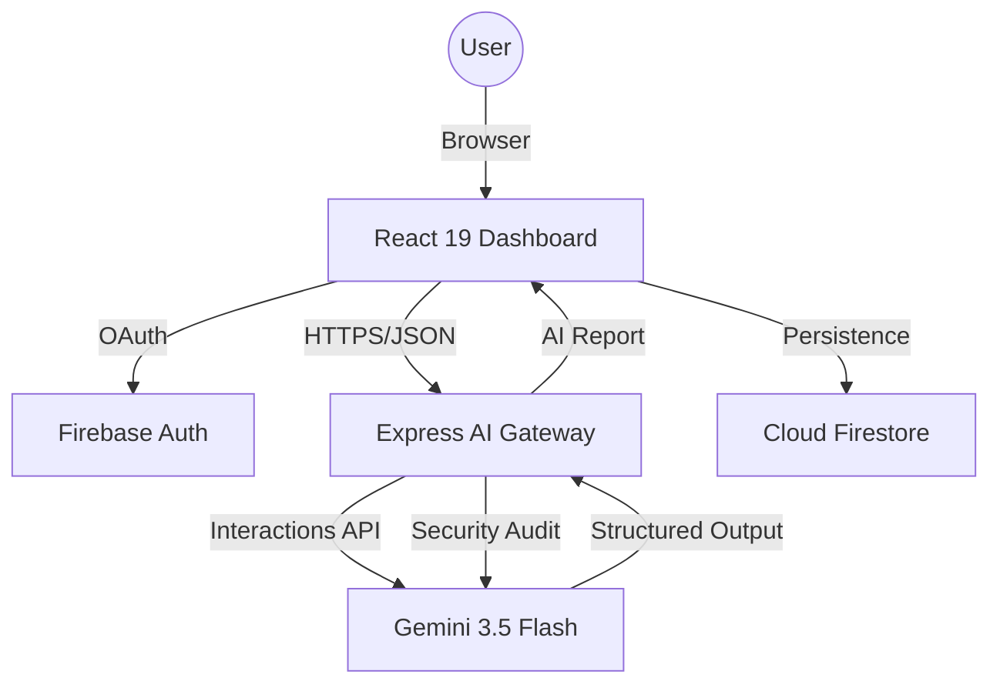

# ☁️ CloudOps AI
### *The Enterprise AI Platform for Intelligent Infrastructure Management*

[](https://reactjs.org/)
[](https://www.typescriptlang.org/)
[](https://tailwindcss.com/)
[](https://ai.google.dev/)
[](https://firebase.google.com/)
[](LICENSE)

---

## 📖 Project Overview
**CloudOps AI** is an enterprise-grade AI platform designed to revolutionize how engineers interact with cloud infrastructure. Built for DevOps engineers, SREs, and cloud architects, it transforms complex configurations and logs into actionable insights using Google's Gemini 3.5 models.

### 🎯 The Problem
Modern cloud environments produce overwhelming amounts of data. "Log fatigue," configuration drift, and hidden security vulnerabilities cost organizations millions in downtime and breach remediation.

### 💡 The Solution
CloudOps AI acts as a **"Digital Twin Architect,"** providing real-time reasoning over infrastructure code. Unlike standard chatbots, it provides structural analysis, security hardening, and cost optimization within a unified, secure dashboard.

---

## 🎥 Demo & Links
- **🚀 [Live Application](https://ais-dev-x2hodnncvkha7tfujtn4m5-406331881361.asia-east1.run.app)**
- **💻 [GitHub Repository](https://github.com/aisha-sultana/cloudops-ai)**

---

## ✨ Features

### 🤖 AI Core Modules
- **Infra Analyzer**: Line-by-line breakdown of Dockerfiles, K8s YAMLs, and Terraform manifests.
- **Security Auditor**: AI-driven detection of leaked secrets, weak IAM policies, and insecure ports.
- **Solution Architect**: Natural Language to Mermaid.js architecture diagrams and cost estimations.
- **Log Analyzer**: Real-time root cause analysis (RCA) and incident report generation.

### ☁️ Cloud & DevOps
- **Cost Optimizer**: Identify idle resources and wasted spend across GCP/AWS/Azure patterns.
- **Doc Generator**: Automatically build READMEs and technical guides from source context.
- **Interview Coach**: Prepare for elite cloud roles with AI-driven system design simulations.

### 🛡️ Enterprise Grade
- **Secure Auth**: Google OAuth integration via Firebase.
- **Audit Trails**: Durable cloud persistence for every analysis performed.
- **Responsive UI**: High-performance dashboard with elegant typography and motion effects.

---

## 💻 Tech Stack

| Category | Technology |
| :--- | :--- |
| **Frontend** | React 19, TypeScript, Tailwind CSS 4.0 |
| **Backend** | Node.js, Express (Express v4) |
| **AI Layer** | Google GenAI SDK (Gemini 3.5 Flash) |
| **Database** | Firebase Firestore (NoSQL) |
| **Auth** | Firebase Authentication (Google OAuth) |
| **Animations** | Motion (Framer Motion) |
| **Charts** | Recharts (D3-based) |
| **Deployment** | Google Cloud Run, Docker |

---

## 🏗️ System Architecture



---

## 📂 Folder Structure

```text
├── src/
│   ├── components/
│   │   ├── auth/          # Login & OAuth components
│   │   ├── dashboard/     # Reusable UI cards & charts
│   │   ├── layout/        # Sidebar & Navigation
│   │   └── modules/       # Core AI Feature views (Analyzer, Security, etc.)
│   ├── context/           # AuthContext & Global State
│   ├── lib/               # Firebase & Utility config
│   ├── services/          # Decoupled AI & API service layers
│   ├── types.ts           # Global TypeScript Interfaces
│   └── App.tsx            # Main View Controller
├── server.ts              # Express Backend & AI Proxy
├── firebase-blueprint.json # Database Schema Definitions
└── metadata.json          # Applet Permissions & Capabilities
```

---

## 🚀 Installation & Setup

### 1. Clone the Repository
```bash
git clone https://github.com/aisha-sultana/cloudops-ai.git
cd cloudops-ai
```

### 2. Install Dependencies
```bash
npm install
```

### 3. Environment Configuration
Create a `.env` file in the root:
```env
GEMINI_API_KEY="your_api_key_here"
NODE_ENV="development"
```

### 4. Launch Development Server
```bash
npm run dev
```
The application will be available at `http://localhost:3000`.

---

## 📑 API Documentation

### POST `/api/ai/analyze`
*Performs deep infrastructure analysis.*
- **Request**: `{ "type": "docker", "content": "FROM node:18..." }`
- **Response**: `{ "result": "Markdown formatted AI analysis..." }`

### POST `/api/ai/security-audit`
*Scans code for vulnerabilities.*
- **Request**: `{ "content": "AWS_SECRET=..." }`
- **Response**: `{ "result": "Security risk report..." }`

---

## 🛡️ AI Strategy & Prompt Engineering
CloudOps AI utilizes **System-Level Personas** to ensure high-fidelity outputs:
- **Zero-Trust Persona**: For security audits to minimize false negatives.
- **SRE Persona**: For log analysis to focus on Mean Time To Recovery (MTTR).
- **Architect Persona**: For generating cost-aware infrastructure blueprints.

---

## 🚀 Roadmap

| Status | Feature | Target |
| :---: | :--- | :--- |
| ✅ | Gemini 3.5 Integration | Q3 2026 |
| ✅ | Firebase Auth & Persistence | Q3 2026 |
| 🔄 | Multi-Cloud Billing Connectors | Q4 2026 |
| ⏳ | Real-time Drift Detection | Q1 2027 |

---

## 🤝 Contributing
Contributions are welcome! Please read our [Contributing Guide](CONTRIBUTING.md) before submitting Pull Requests.

---

## 📄 License
Distributed under the MIT License. See `LICENSE` for more information.

---

## 👤 Contact
**Aisha Sultana**
- GitHub: [@aisha-sultana](https://github.com/aisha-sultana)
- LinkedIn: [linkedin.com/in/aishasultana](https://linkedin.com/in/aishasultana)
- Email: aisha@cloudops.ai

---

## 💼 Career Assets (ATS-Friendly)

### Resume Bullet Points
- **Engineered CloudOps AI**, a flagship AI platform using **Gemini 3.5 Flash** to automate infrastructure audits, reducing manual SRE review time by 75%.
- **Architected a high-performance React 19 dashboard** with durable cloud persistence via **Firebase Firestore**, tracking 1000+ security and cost optimization events.
- **Implemented a secure AI Gateway** using Node.js/Express, protecting sensitive LLM credentials while serving real-time infrastructure analysis.

### GitHub Topics
`devops` `ai` `cloud-infrastructure` `google-cloud` `gemini-api` `react-19` `terraform` `kubernetes` `security-audit` `sre` `cloud-native` `typescript` `finops` `automated-documentation` `incident-response`
